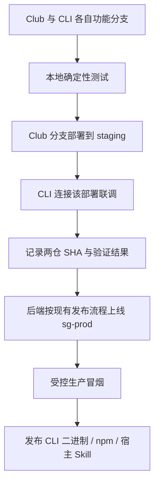

# 贡献指南

## 开发流程

只维护一个 `main`，不增加 `develop`。初始基础提交经仓库所有者授权直接落在 main；之后使用短生命周期分支，提交 PR，检查与 review 通过后 **Squash and merge**。

```bash
git switch main
git pull --ff-only
git switch -c feat/short-description
make check
```

提交采用 `type(scope): description`，说明改了什么、为什么。需求标识放在 commit 和 PR 中，不放在产品代码或注释里。内部关联的 PR 标题只写对应的一个 Multica identifier，避免误关联。

## 模块按职责增加

`cmd/ccneed` 只放进程入口；命令解析放 `internal/cli`。API 客户端、凭证存储、输出与下载按真实需求逐步增加独立模块，不提前创建空目录或通用框架。

开发工具位于 `tools/`；不能成为 CLI 的运行时依赖。宿主 Skill 未来放在 `skills/ccneed/SKILL.md`，只维护一份命令与行为说明，各宿主安装位置由发行安装器适配。

## 先本地测试，再 staging 联调



- `staging` 和 `sg-prod` 是两套环境。测试数据库、存储、队列、任务执行和额度账本不得使用生产资源。
- 开发者通过 `--api-url` 显式选择服务 origin；它只接受 HTTPS 或本机 HTTP，不接受路径、查询、重定向或地址内凭证。正式发行默认 sg-prod，用户无须选择环境。该参数不是任意地址转发器；登录与服务端隔离仍需 staging 验证。
- API、网页登录、回调和会话/报告链接必须跟随同一环境；本地凭证按可信服务地址隔离，服务端也要拒绝跨环境凭证。
- 每轮集成记录 Club **实际部署**的 SHA、CLI SHA 和地址。只改 CLI 时复用同一健康 staging 部署；后端更新或预览过期再部署。现有 staging 预览默认有效期为 4 小时。
- 本地 API 替身用于契约和错误路径测试，不能替代真实 staging 登录、任务、HITL、文件及报告下载闭环。
- 不改变 Club 原有 develop → release/hotfix → main → Tag 部署流程。CLI 合并 main 不自动发布 npm，更不触发生产服务部署。

## 质量门禁

`make check` 与 `bash scripts/check.sh` 是同一入口，检查时不自动改源码：

1. gofmt、依赖文件一致性。
2. Google 风格注释结构及禁止 issue 编号的代码注释。
3. go vet、固定版本 golangci-lint。
4. 单元/集成测试与构建；Linux CI 额外执行 race 检测。

GitHub Actions 在 Linux、macOS、Windows 执行测试与构建，Linux 额外执行完整 Go 门禁、race 检测、审查脚本行为测试与固定版本 actionlint。Go 本地门禁不因此增加 Node 运行依赖；修改 CI 时另外执行 `node --test scripts/cx-review/*.test.mjs`。

main 的规则应要求 `quality` 和提交状态 `cx-review` 均通过，并要求分支包含最新 main。**仅提交 workflow 不等于已启用分支保护。** 不用可被跳过的 review job 代替必需的提交状态。

第一阶段不设置任意覆盖率百分比。新增行为必须有能抓住回归的测试，覆盖率用于 review，不写凑数测试。先确认测试失败，再实现并确认通过。

## PR 与发布

使用 PR 模板说明范围、测试证据和风险。CX Review 直接调用 Codex CLI 和仓库内 `review-pipeline` Skill，分别审查正确性、模块边界、安全、需求一致性。Critical / Important 候选由独立调用二次核实，确认后阻止合并；Minor 提醒改进。缺失报告、审查失败、上下文不完整不能显示通过。

普通测试只在无生产凭证的 GitHub-hosted runner 执行。模型审查只读取可信 main 的控制代码与预先收集的 PR 数据，不执行 PR 代码，不加载 PR 配置。外部 PR 等待维护者从 main 手动批准具体 head SHA；有新提交就重新批准。发布结果前再次核对 head / base，旧结果不能给新提交放行。

首次接入需先人工完成同等四类审查，将可信控制代码合入 main，再配置隔离的临时 review runner 和必需检查。操作步骤、配置开关与验证要求见 [CX Review 运维说明](.agents/skills/review-pipeline/references/operations.md)。未配置或未实测前，不能宣称自动 review 已启用。

发布前确认 sg-prod 服务兼容，再验证生产登录与受控任务闭环。npm 发布、GitHub Release 和许可证选择需要单独授权；本仓当前不配置自动发布工作流。生产凭证不进入仓库、CI 日志或外部贡献者 PR。

CLI 发行使用独立的 `vX.Y.Z` tag；npm、二进制的 `ccneed version` 和随包 Skill 属于同一版发行，不沿用 Club 的服务版本。预发行使用 `vX.Y.Z-rc.N`，不能进入 npm `latest` 或普通用户更新提醒。推送开发提交不等于发行，也不自动打 tag。

发行门禁需要校验 tag 与程序/npm 版本一致、各平台产物及校验值完整、npm `latest` 已指向该稳定版且包可下载，再对用户宣布可更新。GitHub Release 存在但 npm 尚未就绪时，npm 安装的客户端不能提醒升级。安装器的渠道识别和 npm 就绪检查尚待发行模块实现；当前源码入口按 GitHub 正式发行检查，不伪造已发布的 npm 包名。
