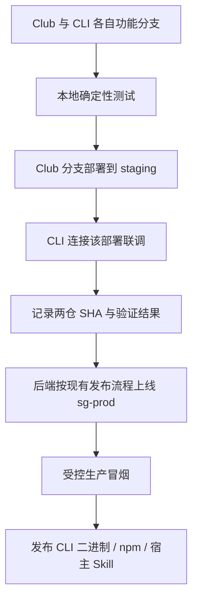

# 贡献指南

## 开发流程

只维护一个 `main`，不增加 `develop`。初始基础提交经仓库所有者授权直接落在 main；之后使用短生命周期分支，提交 PR，检查与 review 通过后 **Squash and merge**。

```bash
git switch main
git pull --ff-only
git switch -c feat/short-description
make check
```

提交采用 `type(scope): description`，说明改了什么、为什么。需求标识放在 commit 和 PR 中，不放在产品代码或注释里。内部关联的 PR 标题只写对应的一个 Multica identifier，避免误关联。

## 模块按职责增加

`cmd/ccneed` 只放进程入口；命令解析放 `internal/cli`。API 客户端、凭证存储、输出与下载按真实需求逐步增加独立模块，不提前创建空目录或通用框架。

开发工具位于 `tools/`；不能成为 CLI 的运行时依赖。宿主 Skill 未来放在 `skills/ccneed/SKILL.md`，只维护一份命令与行为说明，各宿主安装位置由发行安装器适配。

## 先本地测试，再 staging 联调



- `staging` 和 `sg-prod` 是两套环境。测试数据库、存储、队列、任务执行和额度账本不得使用生产资源。
- 开发者的 `--api-url` 是待实现的受控入口，不是任意地址转发器。正式发行默认 sg-prod，用户无须选择环境。
- API、网页登录、回调和会话/报告链接必须跟随同一环境；本地凭证按可信服务地址隔离，服务端也要拒绝跨环境凭证。
- 每轮集成记录 Club **实际部署**的 SHA、CLI SHA 和地址。只改 CLI 时复用同一健康 staging 部署；后端更新或预览过期再部署。现有 staging 预览默认有效期为 4 小时。
- 本地 API 替身用于契约和错误路径测试，不能替代真实 staging 登录、任务、HITL、文件及报告下载闭环。
- 不改变 Club 原有 develop → release/hotfix → main → Tag 部署流程。CLI 合并 main 不自动发布 npm，更不触发生产服务部署。

## 质量门禁

`make check` 与 `bash scripts/check.sh` 是同一入口，检查时不自动改源码：

1. gofmt、依赖文件一致性。
2. Google 风格注释结构及禁止 issue 编号的代码注释。
3. go vet、固定版本 golangci-lint。
4. 单元/集成测试与构建；Linux CI 额外执行 race 检测。

GitHub Actions 在 Linux、macOS、Windows 执行测试与构建，Linux 执行完整门禁。汇总检查名为 `quality`；仓库规则启用后，应将其设为 required check。**仅提交 workflow 不等于已启用分支保护。**

第一阶段不设置任意覆盖率百分比。新增行为必须有能抓住回归的测试，覆盖率用于 review，不写凑数测试。先确认测试失败，再实现并确认通过。

## PR 与发布

使用 PR 模板说明范围、测试证据和风险。至少完成正确性、模块边界、安全、需求一致性四类 review；自动审查服务未接入前，不能宣称自动 review 已启用。

发布前确认 sg-prod 服务兼容，再验证生产登录与受控任务闭环。npm 发布、GitHub Release 和许可证选择需要单独授权；本仓当前不配置自动发布工作流。生产凭证不进入仓库、CI 日志或外部贡献者 PR。
