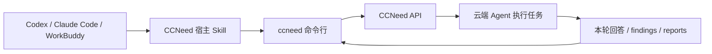

# CCNeed CLI

把 CCNeed 云端 Agent 接入你常用的 Agent，而不是再学习一款产品。

CCNeed CLI 是 Go 编写的完整命令行接入工具，配套宿主 Skill，让已有 Agent 使用 CCNeed 的云端能力。任务在云端执行；本地负责登录、资源绑定、任务恢复、用户确认和结果获取，不复制 Agent runtime。

> 当前处于开发阶段，尚未发布 npm 包或用户可用的 CLI。不要使用未经确认的同名 npm 包。安装命令和宿主 Skill 会在首个可用版本中一起提供。



## 第一版要解决什么

- 复用官网登录，无须另外设置密码。
- 提交长程任务后立即返回会话与回合标识，再按需查看进度。
- 遇到需要用户确认的问题，以结构化参数回答并继续任务。
- 上传文件、查看知识库，并在对话中追加文件或补绑知识库。
- 复杂的知识库创建操作打开网页完成，不把整个创建界面搬进命令行。
- 查看本轮结果及工作空间中的 findings、reports，下载报告到本地。
- 查看账号可用积分、有效订阅及近期积分记录。

以上是目标能力，**不是当前已实现的命令清单**。平台 Skill/MCP 配置管理、Bot 和 MCP 接入暂不开放；云端已有配置仍由平台决定。

## 开发入口

需要 Go 1.25 或更高版本、Git，以及 Bash（Windows 可使用 Git Bash）。

```bash
git clone https://github.com/validflow/ccneed-cli.git
cd ccneed-cli
make check
```

没有 GNU Make 时，执行 `bash scripts/check.sh`。门禁检查代码格式、注释规范、静态分析、lint 和测试，不依赖线上账号。

当前功能分支已提供可测试的 HTTP、账号查询和更新提醒模块。可运行的开发命令：

```bash
go run ./cmd/ccneed --help
go run ./cmd/ccneed version
```

`account overview`、`account credits`、`account history --limit 20` 已完成命令和接口测试，但官网登录尚未接通，独立执行会返回 `not_authenticated`，不能用于真实账号查询。`history` 只展示现有接口的近期窗口（最多 200 条），不代表完整历史。

正式版本的更新提醒只写 stderr，不污染 JSON 结果，也不自动升级；开发版本不检查更新。npm 发行查询 npm 稳定 `latest`，不会仅因出现 GitHub tag 就提示升级。自动检查缓存 24 小时，网络请求最多等待 2 秒；使用 `--no-update-check` 可关闭本次检查。精确版本安装、校验和及自动发行脚本已有本地实现，但尚未真实发版；登录、任务、文件、HITL、宿主 Skill 安装与 staging 联调仍待完成。

| 文档 | 内容 |
| --- | --- |
| [贡献指南](CONTRIBUTING.md) | 分支、PR、staging 联调与发布顺序 |
| [代码规范](CODE_STYLE.md) | 模块边界、Google 风格注释、测试和错误处理 |
| [安全说明](SECURITY.md) | 凭证、环境隔离与漏洞报告 |
| [发行说明](RELEASING.md) | 维护者版本准备、自动发布与失败恢复 |

## 安装与开源状态

首个发行版本计划通过 npm 安装平台二进制，并提供配套宿主 Skill；具体包名和安装命令以正式发布时的 README 为准。普通用户只连接 sg-prod。

仓库当前为 private。公开前需要确认许可证、完成密钥与依赖审查，并验证安装及卸载流程；当前没有授予开源许可证。
