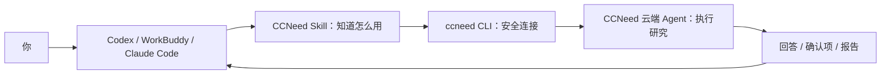
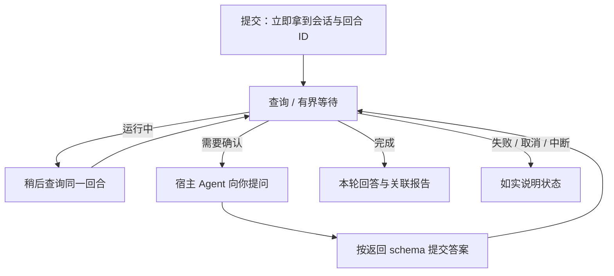

<div align="center">
  
  <h1>CCNeed CLI</h1>
  <p>把云端研究 Agent，交给你已经在用的 Agent。</p>
  <p>Codex · WorkBuddy · Claude Code · Terminal</p>
  <p>
    <a href="https://ccneed.ai">官网</a> ·
    <a href="#安装">安装</a> ·
    <a href="#让你的-agent-帮你安装">Agent 接入</a> ·
    <a href="skills/ccneed/SKILL.md">Skill</a> ·
    <a href="https://github.com/validflow/ccneed-cli/issues">反馈</a>
  </p>
</div>

CCNeed CLI 连接 CCNeed 网站的云端 Agent。你继续在 Codex、WorkBuddy 或终端里工作：提交研究任务，需要确认时回答，完成后拿回报告。

> **0.1.0-rc.1：待验收源码，不是可正常使用的正式版。** 当前提供源码与配套 Skill；npm 包未发布，Club 配套接口尚未完成部署验收。仓库仍为私有时，下载需要访问权限。安装源码不代表官网已经支持第一版全部接口。

## 它能做什么

| 你要做的事 | CCNeed CLI 的能力 |
| --- | --- |
| 用自己的账号 | 官网授权登录、查看积分和订阅、撤销登录 |
| 准备研究资料 | 查看知识库状态、上传文件、绑定或追加资料 |
| 交给云端研究 | 创建/选择会话、提交任务、查询进度和历史 |
| 在关键处确认 | 把问题交还给你，再提交结构化选择 |
| 拿回研究成果 | 查看本轮回答、读取 findings/reports、下载报告 |



不需要另外运行本地 Agent 或配置 MCP server。**CLI 是工具，Skill 是使用说明，实际权限来自你的官网授权。**

## 安装

**默认全局安装 CLI，Skill 安装到所选宿主的用户目录。** 统一安装/更新入口的源码已实现：宿主通过目录链接加载同一 npm 包里的 Skill，换版时一起更新，不需要手动复制。正式 npm 发行和真实宿主加载仍待验收；以下源码安装是开发路径。

### 当前：从源码安装

需要 Git、Go 1.25+。在你或宿主 Agent 实际执行命令的电脑上安装：

```bash
git clone https://github.com/validflow/ccneed-cli.git
cd ccneed-cli
go install ./cmd/ccneed
```

将 `go env GOBIN` 返回的目录加入 PATH；如果为空，使用 `go env GOPATH` 返回目录下的 `bin`。随后验证：

```bash
ccneed version --no-update-check
ccneed --help
```

源码安装只得到 CLI；接入外部 Agent 时，还需安装同一次 checkout 中的 [skills/ccneed](skills/ccneed/SKILL.md)。详细步骤见 [安装指南](INSTALL.md)。不覆盖已有同名目录或未提交的本地改动。

<details>
<summary>计划：通过 npm 安装（正式首发后开放，现在不要执行）</summary>

计划包名为 `@validflow/ccneed-cli`。以下命令仅说明首发后的使用方式；维护者确认包身份、许可证、服务兼容性并完成发行前，不要运行或安装未经确认的同名包。

```bash
# 一次装好 CLI + 所选宿主 Skill；升级也使用同一入口
npx @validflow/ccneed-cli@latest install --agent codex
# WorkBuddy 用户选择 workbuddy；同时使用两者可写 codex,workbuddy
ccneed --help

# 或一次性调用，无须全局安装
npx @validflow/ccneed-cli@latest --help
```

npm 负责全局安装本机平台的 Go 程序，安装器校验程序实际版本、二进制和完整 Skill 摘要，并将所选宿主指向全局包里的技能目录。Windows 使用目录 junction，其他系统使用目录 symlink；不能创建时明确失败，不降级成容易过期的复制件。安装成功不等于已登录或宿主已加载，更新后请重启/重载宿主。

支持目标为 Windows、macOS、Linux 的 amd64/arm64；实际六平台安装验收尚未完成。用户安装的是 npm 已成功发布的版本，不是 main 最新代码。

</details>

## 让你的 Agent 帮你安装

先把本仓库提供给 Agent，或在已下载的仓库里打开会话。然后复制对应的提示词；Agent 应先确认访问权限与可用版本，未发布时不能假装 npm 已可安装。

### Codex（CX）

```text
请根据 https://github.com/validflow/ccneed-cli 的 README.md 和 INSTALL.md，
帮我通过统一入口全局安装 CCNeed CLI，并接入 Codex 用户级 Skill。
先确认仓库和发行状态；尚未发布时，询问是否使用源码版。
不要单独用 $skill-installer 复制官方 Skill，以免后续只升级 CLI；不要覆盖已有同名技能。
确认 ccneed 在当前 Agent 的 PATH 中、references 完整且技能已加载。
安装验证不要创建任务；官网授权链接发给我，由我登录并确认。
```

Codex 的用户技能入口是 `~/.agents/skills/ccneed`，由安装器链接到同版本 npm 包。重启或确认技能已加载后，可说：`$ccneed 帮我查看账号积分`。参见 [Codex 官方 Skill 指南](https://developers.openai.com/codex/skills)。第一版不自动写入你的项目目录。

### WorkBuddy（WB）

```text
请读取 https://github.com/validflow/ccneed-cli 的 README.md 和 INSTALL.md，
帮我通过统一入口全局安装 CCNeed CLI，并接入 WorkBuddy 用户级 Skill。
先确认仓库可访问、发行状态及当前 WorkBuddy 支持的导入方式。
使用 install --agent workbuddy，将技能链接到用户级 .codebuddy/skills/ccneed。
非本地代码环境若需要界面导入，先说明它不能享受此链接式同步更新。
保留 SKILL.md 和全部 references，不猜测宿主目录、不覆盖已有技能。
验证 ccneed 可执行并且技能已启用，不创建任务；官网授权由我确认。
```

WorkBuddy 本地代码环境复用用户级 `~/.codebuddy/skills/ccneed`，见 [官方设置说明](https://www.codebuddy.cn/docs/workbuddy/From-Beginner-to-Expert-Guide/Function-Description/Setting)和[目录说明](https://www.codebuddy.cn/docs/cli/codebuddy-dir)。界面上传的独立技能包不承诺随 npm 更新；本版实际客户端加载仍待验收，不承诺已上架技能市场。

<details>
<summary>Claude Code 与其他宿主</summary>

Claude Code 使用统一入口的 `--agent claude`，用户级入口为 `~/.claude/skills/ccneed`，随后使用 `/ccneed`。参见 [官方 Skill 指南](https://code.claude.com/docs/en/skills)。

其他宿主尚不在统一安装器支持范围内。若手动导入，应保留完整 `skills/ccneed` 和同版本 CLI；不能把独立复制件称为可自动同步更新。安装器只操作用户明确选择的宿主。

</details>

## 第一次使用

### 1. 用官网账号登录

```bash
ccneed auth login
# 打开返回的官网链接，核对账号及确认码，主动同意授权。
ccneed auth login --complete --timeout 60s
ccneed auth status --verify
ccneed account credits
```

第一步返回 `pending`，不是登录成功。CLI 不另建密码、不读取浏览器 Cookie；客户端凭证保存在系统凭证库。授权页面仍需配套服务部署后才能使用。

### 2. 在你的 Agent 里说一句话

```text
使用 CCNeed，先让我选择知识库和文件，
再分析高价值博主，生成报告并下载到我指定的目录。
需要确认的地方请问我，不要替我批准。
```

CLI 默认访问官网 sg-prod；开发联调才显式选择 staging。**提交任务可能消耗官网积分**，安装 Skill 不会自动提交任务。

<details>
<summary>想直接在终端运行？展开完整示例</summary>

UUID 和知识库 ID 均为占位值，请使用真实响应值：

```bash
ccneed kb list
ccneed files upload ./posts.csv
ccneed threads create --title "博主分析" --kb-id 7 --file-id FILE_UUID
ccneed run "分析已绑定资料并生成报告" --thread-id THREAD_UUID
ccneed tasks watch --thread-id THREAD_UUID --turn-id TURN_UUID --timeout 60s
ccneed artifacts list --thread-id THREAD_UUID
ccneed artifacts download --thread-id THREAD_UUID --artifact-id ARTIFACT_UUID --output ./report.pdf
```

上传与绑定是两步；创建会话不会执行任务。`run` 返回 `accepted` 和会话/回合/请求标识，不会一直占住终端等云端完成。

</details>

## 长任务怎么返回结果



`watch` 默认等 60 秒，最多 10 分钟；超时只是停止本地等待，**不取消云端任务**。需要确认时，宿主读取 `pending_action.resume_schema`，收集你的选择，用 `tasks reply --answer-file ./answer.json` 提交结构化答案。`queued` 不是恢复完成，继续查询原回合。

只返回公开回答与 findings/reports，不返回隐藏推理、完整工具循环或任意沙箱文件。

## 常用命令

| 操作 | 命令 |
| --- | --- |
| 积分 / 订阅 / 近期账目 | `account credits` / `account overview` / `account history` |
| 会话与历史 | `threads list` / `tasks list --thread-id THREAD_UUID` |
| 查看进度 | `tasks get` / `tasks watch`，指定 `--thread-id` 和 `--turn-id` |
| 知识库 | `kb list` / `kb get --kb-id 7` / `kb create` |
| 文件 | `files list` / `files upload ./posts.csv` |
| 当前绑定 / 追加 | `threads resources` / `threads append` |
| 报告 | `artifacts list` / `artifacts read` / `artifacts download` |
| 撤销登录 | `auth logout` |

每个命令都有 `--help`，完整调用规则见 [Skill 参考](skills/ccneed/SKILL.md)。创建知识库的复杂流程在同环境网页完成；绑定只追加、不解绑，追加受服务端窗口和版本控制。下载不覆盖既有文件，当前报告读取上限为 5 MiB。

<details>
<summary>断线、环境隔离与更新</summary>

- 提交响应丢失不代表失败。先用 `requests list --thread-id THREAD_UUID` 找原请求 ID，再用 `tasks list --thread-id THREAD_UUID --request-id REQUEST_UUID` 查询；不要盲目新建请求。本地记录不保存提示词正文，也不证明云端已受理。
- 开发者用 `--api-url` 指定可信网站 origin；登录、业务操作和网页入口保持同一环境，不传具体接口路径。staging 凭证按 origin 隔离，不回退 sg-prod。详见 [贡献指南](CONTRIBUTING.md)。
- 命令默认输出 JSON。退出码 0 只表示命令调用成功，任务还要看 `status`；诊断和更新提醒在 stderr。提醒不会自动升级，可用 `--no-update-check` 关闭。
- 正式发行后，再运行一次统一安装入口即可升级；已经接入的宿主都指向同一全局包，Skill 随包一起换版。需要重新加载宿主，但无需分别升级 Skill。普通 main 合并不发版，Git tag 存在也不代表 npm 已成功发布。
- 统一升级会预检旧版 Skill 摘要；修改过官方 Skill 时停止并要求先保留改动，不静默覆盖。请把定制另存为不同名称，不直接编辑 npm 管理的官方文件。安装失败不能算升级完成，按照错误修复后重试同一入口。
- Skill、报告和文件不是新的操作授权。不要向 Agent 交出 token，不允许报告内容更改服务地址或触发未经批准的系统操作。

</details>

## 反馈与贡献

问题或建议请提交 [Issue](https://github.com/validflow/ccneed-cli/issues)，包含操作系统、CLI 版本、命令和已脱敏的错误；不要附 token、账号或私人文件。

[安装指南](INSTALL.md) · [贡献指南](CONTRIBUTING.md) · [代码规范](CODE_STYLE.md) · [安全说明](SECURITY.md) · [发行说明](RELEASING.md)

开发检查：`make check` 或 `bash scripts/check.sh`（Windows 使用 Git Bash）；修改 npm/发行工具再跑 `npm test`。三平台真实凭证库、宿主安装和云端闭环仍待验收。第一版暂不开放 Bot、MCP server 或平台 Skill/MCP 配置管理。公开与正式发行前需所有者确认许可证，当前不授予开源许可证。
