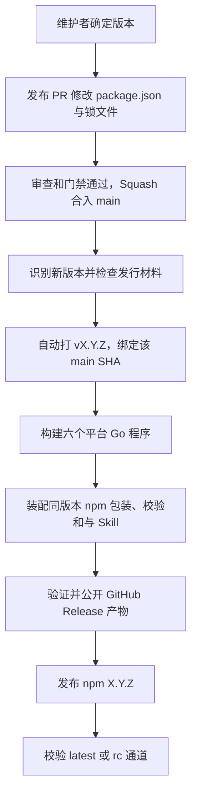

# CLI 发行

维护者决定版本号；版本变更经 PR 合入 main 后，CI 自动执行后续步骤。普通功能合并不发版，不按 feat/fix、分支名或提交数量计算版本。



Git tag 不等于 npm 已发布。用户通过 npm registry 安装，不直接读取 GitHub main。发行通过一个工作流连续执行；不依赖 GitHub token 创建的 tag 再触发第二个工作流。

## 首次启用前

当前 `package.json` 与锁文件使用 `0.1.0-rc.1`、`private: true`、`UNLICENSED`。这是待验收源码里程碑，尚不能用于用户安装。合并后经维护者确认，可手动将 `v0.1.0-rc.1` 绑定该 main 提交；不创建公开 Release 或 npm 包，也不移动已有 tag。

私有包更新版本只记录源码，不生成发行计划。只有明确解除 `private` 禁发、通过包身份/许可/材料预检并开启发行开关后才进入发行；首次启用可以使用同一版本，但须校验既有 tag 绑定的提交，若源码已经变化则使用新版本。统一宿主安装器目前只支持正式版，npm RC 安装不是本次里程碑承诺。

1. 完成真实 staging 联调，确认兼容服务已上线 sg-prod；CLI 发行不部署 Club。
2. 确认 npm 包名、首发版本、开源许可及仓库公开策略；添加实际 `LICENSE`、`CHANGELOG.md`、可用的 `skills/ccneed/SKILL.md`，不是占位说明。
3. 确认 main 的 PR、CX Review 和质量保护已启用。仅存在 workflow 文件不代表这些设置已生效。
4. 在 npm 为实际包配置 trusted publisher：组织 `validflow`、仓库 `ccneed-cli`、工作流 `release.yml`、环境 `npm-release`，允许 `npm publish` 和 `npm dist-tag`。首次建立包与权限的步骤单独确认；不在源码中保存长期发布 token。
5. GitHub 的 `npm-release` 环境仅允许 main；若希望全自动，不设置每次发布都需人工批准的 environment reviewer。生产资源凭证不进入此环境。
6. 明确授权后，维护者才将仓库变量 `CCNEED_RELEASE_ENABLED` 设为 `true`。本次开发不修改该变量，也不选择许可证或真实发布。

npm OIDC 要求受支持的 Node/npm 与 GitHub-hosted runner；`dist-tag` 的 OIDC 恢复至少需要 npm 11.21.0（12.x 至少 12.2.0）。工作流使用 Node 24 并固定 npm 11.21.0，不依赖 Node 自带的 npm 版本。public npm 包的 provenance 与私有仓库支持限制，启用前按 [官方说明](https://docs.npmjs.com/trusted-publishers/) 核验。

## 每次发行

在新功能分支中执行，不直接修改 main：

```bash
# 仅更新 manifest/锁文件，不在本地打 tag
npm version 0.1.1 --no-git-tag-version --ignore-scripts
# 同步 CHANGELOG.md 后检查
npm test
bash scripts/check.sh
```

发布 PR 经审查后 Squash 合并。CI 对该合并提交执行预检、打 tag、构建和发布。保持一次发行完成后再合下一次版本 PR；GitHub concurrency 只保留一个待执行发行，不将其当作无限队列。

版本唯一来源是 `package.json.version`。锁文件根版本及根包版本要同步，二进制注入同一版本/提交/包名。稳定发行使用 `vX.Y.Z` 与 npm `latest`；预发布使用 `vX.Y.Z-rc.N` 与 npm `rc`，不进入普通用户更新提醒。不兼容变更的版本选择由维护者审查，0.x 的具体约定待首发前确认。

产物支持 Linux、macOS、Windows 的 amd64/arm64。每个平台提供独立可执行文件，npm 安装器按自身精确版本下载，校验 SHA-256 后才安装；不要求用户安装 Go，也不解压不可信归档。npm 包含同一源码版本的完整 Skill 和统一安装器模块；校验和另包含 Skill 完整文件摘要。统一入口全局安装精确版本 CLI，将所选宿主的用户级目录链接到同包 Skill，并校验程序实际版本和 Skill 摘要。已有宿主入口随全局包一起更新，不维护独立复制件；真实宿主加载仍需验收。

## 失败与重试

- 缺失版本、许可、Skill、锁文件或质量门禁失败：在打 tag 前停止。
- tag 已存在：只有指向同一 main SHA 才能复用，绝不移动 tag。
- GitHub 草稿只补缺失文件；已有文件逐个下载比对，禁止覆盖不同字节。公开 Release 缺产物时停止，不悄悄补发改变既有版本。
- npm 已存在该版本：只有精确 tarball integrity 相同才能复用；不覆盖版本，不把稳定通道倒退。
- Actions 保存构建产物 30 天。临时网络/权限错误可重跑同一次 Release workflow；源码、构建工具或内容改变导致字节不同，应使用保留的原始产物或新版本，不强行复用旧号。
- GitHub 已公开、npm 未完成：npm 安装渠道不会因 GitHub tag 单独提醒更新。修复权限/网络后恢复该发行，不向用户宣告成功。

发布成功以 GitHub 产物、npm 版本内容及目标通道均校验通过为准。更新检查按 npm 稳定 latest，缓存 24 小时、请求最多 2 秒，失败不阻塞命令且提示不写 stdout。提醒不会静默升级；用户同意后运行统一安装入口，CLI 与已接入宿主的 Skill 同包换版。旧 Skill 修改会阻止统一升级，客户端需重载，手工复制或界面上传不在联动范围；完整规则见 [安装指南](INSTALL.md)。此机制的源码测试通过不代表 npm 已发行。
